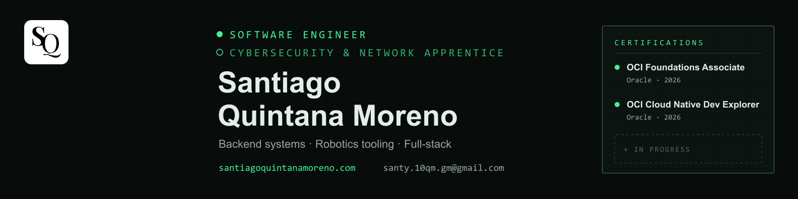

<h1 align="center">Hello, I'm Santiago 👋</h1> 

Backend & Cloud · Robotics · Embedded Systems · Avionics Software · WebDev · Full Stack
 
 
 
 
  

---

## 🌟 About Me

I'm **Santiago Quintana**, a Computer Technologies Engineering student at **Tecnológico de Monterrey**. I build things where backend and cloud engineering meet robotics, embedded systems, and avionics software, and I mentor FTC robotics teams along the way.

**Open to:** internships, freelance backend work, and collaborations on robotics or embedded projects.

**Right now:** Internship at PWT Agua Optima mantaining enterprise software, building a physical networking lab and AI-driven SOC on Cisco hardware with OpenSource software, fall-semester with a cybersecurity concentration @TecDeMonterrey,and mentoring FTC team Overture.

**Languages:** Spanish · English · German (B1 → B2 in progress)

---

## 🚀 Featured Projects

### 🔮 Andromeda: Oracle Task Management Bot
A Spring Boot + Telegram task-management platform built for an Oracle dev team through Atherion Systems, my Software Engineering course's student org. I served as **Product Owner and CTO** on a six-person team, taking the project from architecture to final delivery.

- **Stack:** Spring Boot microservices, Oracle Autonomous DB, Flyway, JPA, React/TypeScript, Telegram Bot, Groq/Gemini RAG layer
- **My part:** OKE infrastructure, CI/CD pipeline, HTTPS via cert-manager/Let's Encrypt, OAuth2/PKCE with OCI IAM, RBAC, blue-green deployment manifests, Qodana static analysis
- **Hardening:** OWASP ZAP and Sn1per scans with formal reports, DB privilege minimization, network security lists
- **Docs:** PGCS/IEEE 828, SRS, DIYAS architecture, risk matrix, quality and test plans
- **Result:** delivered mid-June 2026, and the final presentation ranked best in the cohort

[Frontend](https://github.com/AtherionSystems/Andromeda_web) · [Backend](https://github.com/AtherionSystems/Andromeda_db_API)

---

### ✈️ Airbus Systems Simulation
A physics-centered simulation of Airbus avionics systems in C++, ImGui, and SDL2: ECAM, PFD, autopilot, and checklist operations.

<!-- Add a GIF or screenshot here, for example:  -->

[View the repo](https://github.com/SantiQ0905/Airbus_SysSim)

---

### ⚙️ ESP32-C6 Line Follower Robot
A complete embedded robotics project: TCRT5000 sensor array with a CD74HC151 multiplexer, DRV8833 motor driver, PID control with speed modes, and a custom PCB with calibration firmware. Built for LARC 2025.

<!-- Add a photo of the PCB or the robot here, and one line with the competition result -->

[View the repo](https://github.com/SantiQ0905/LARC_2025)

---

### 🤖 overftclib / overftclib-rc
A modern FTC robotics library inspired by FRC's CommandBase and WPILib, built for command-based architecture in Java and used by regional teams.

<!-- Add one line on adoption, for example how many teams use it -->

[overftclib](https://github.com/SantiQ0905/overftclib) · [overftclib-rc](https://github.com/SantiQ0905/overftclibrc)

---

### 🌐 Physical Networking Lab (in progress)
A multi-router topology originally designed in Packet Tracer (MTY, Saltillo, and a remote site), now being implemented on real Cisco Catalyst 1300 hardware. Covers DHCP, VLANs, OSPF, routing tables, subnetting, and ACL fundamentals.

---

### 📱 Amoxcalli LSM: Backend & Android App
A full-stack educational system with Firebase Auth, JWT, PostgreSQL, and a multi-module Android app.

[App](https://github.com/SantiQ0905/Amoxcalli_App) · [API](https://github.com/SantiQ0905/KetzalliDB_API)

---

### 📂 More projects

- **FTC & FRC robot code:** command-based Java architectures with PID controllers, odometry, and vision pipelines. [FTC Hornet 2026](https://github.com/Overture-7421/Hornet-2026-23619) · [FRC Mulssane 2022](https://github.com/Overture-7421/Mulssane-2022)
- **TidyMesh:** a multi-agent simulation exploring task allocation and agent movement strategies. [Repo](https://github.com/SantiQ0905/TidyMesh_Sim)

---

## 🧰 Tech Stack

The full, filterable list lives on [my website](https://www.santiagoquintanamoreno.com/). Here is the short version.

**Core Languages (14)**

`C++` `C#` `Java` `Python` `SQL` `PL/SQL` `TypeScript` `JavaScript` `Kotlin` `R` `MATLAB` `HTML` `CSS` `Dart`

**Frameworks & Libraries (12)**

`Node.js` `Express` `SpringBoot` `React` `Vite` `TailwindCSS` `HeroUI` `Mantine` `MaterialUI` `Flutter` `PlatformIO` `Arduino`

**Data & APIs (10)**

`Oracle Autonomous DB` `MySQL` `SQL Server Express` `PostgreSQL` `DataGrip` `Flyway` `Postman` `Railway` `Vercel` `Render`

**Infra & Tooling (22)**

`Oracle Cloud Infrastructure` `Firebase` `Docker` `Kubernetes` `OKE` `Git` `Git LFS` `GitHub` `GitHub Actions` `VSCode` `JetBrains IDE` `Gradle` `Maven` `YAML` `JSON` `XML` `WSL` `Cloudflare R2` `Anaconda` `PyInstaller` `Qodana` `Super-Linter`

**Also working with**

- **Security:** OAuth2/PKCE with OCI IAM, cert-manager, OWASP ZAP, Sn1per
- **Networking:** Cisco CLI, Packet Tracer, VLANs, OSPF, DHCP, ACLs
- **Robotics & Embedded:** ESP32-C6, custom PCBs, PID control, odometry
- **Algorithms:** multi-agent systems, graph theory, optimization heuristics

---

## ✍️ Lumenforge

🪄 **Stories shaped by emotion, structure, and cinematic engineering.**
Where love, resilience, time, and memory intersect with technical precision.

Lumenforge is my creative imprint. A couple of essays to start with, Both in spanish:
- [Mis observaciones y opiniones: La La Land (2016)](https://www.santiagoquintanamoreno.com/writing/la-la-land-2016)
- [Edward Snowden: La reflexión de valentía por la libertad](https://www.santiagoquintanamoreno.com/writing/edward-snowden-permanent-record)

---

## 🌐 Let's Connect

📧 **santy.10qm.gm@gmail.com** · 🌎 [santiagoquintanamoreno.com](https://www.santiagoquintanamoreno.com/)

